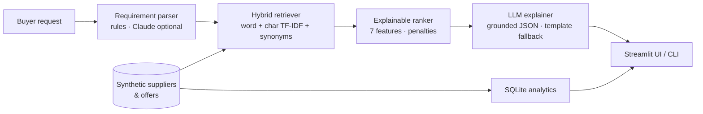

# 🏭 AI-Powered B2B Supplier Recommendation Assistant

Describe what you want to buy in plain language, and the assistant **extracts your requirements, retrieves matching offers, ranks suppliers on transparent criteria, and drafts your RFQ email**.

> Built as a portfolio project for B2B marketplace sourcing (inspired by platforms like IndiaMART).
> **All data is synthetic**, and the project is not affiliated with or endorsed by IndiaMART or any marketplace.

```
"Need 500 solar panels 550W near Pune, BIS certified, under 12000 per piece"
        │
        ▼
 Parsed: product=solar panels 550w · qty=500 · city=Pune · BIS · ≤ ₹12,000/unit
        │
        ▼
 1. Vishwa Exports (Pune)   ₹9,992/piece   score 86
    ✔ Based in Pune, your delivery city  ✔ 83% response rate, ~2h  ✔ Holds BIS
    ⚠ Not GST verified
```

## Why this problem

Buyers on B2B marketplaces face thousands of near-identical listings. Choosing a supplier means weighing relevance, trust, speed of response, location, price, minimum order quantity (MOQ) and compliance, and then writing a quote request. This project automates that workflow and keeps every recommendation **explainable**.

## Features

- **Natural-language requirement parsing**: quantity, unit, per-unit price cap or total budget, city (with aliases such as Bangalore → Bengaluru), certifications (BIS, ISO 9001, FSSAI, CE…), urgency, "verified only". Spec numbers like `550W` are not mistaken for quantities.
- **Typo- and jargon-tolerant hybrid retrieval**: word + character TF-IDF with a domain synonym table (`"sollar pannel"`, `"rebar"`, `"haldi"`).
- **Explainable multi-criteria ranking**: seven weighted features, context-aware weights, user-adjustable sliders, and penalties when a supplier violates a stated constraint. Every result shows *reasons* and *flags*.
- **Grounded LLM layer (Claude, optional)**: comparison summary, questions to ask the supplier and an RFQ email. The LLM never picks suppliers; replies are validated against the ranked list, with deterministic template fallbacks.
- **SQL market analytics**: window functions, joins and aggregates on a SQLite copy of the data (`sql/analytics.sql`).
- **Offline evaluation + unit tests + CI**.

## Architecture



## Quick start

```bash
git clone <your-repo-url> && cd b2b-supplier-recommender
python -m venv .venv && source .venv/bin/activate      # Windows: .venv\Scripts\activate
pip install -r requirements.txt

streamlit run app.py                                    # web demo
python -m supplier_assistant.cli "200 polo t-shirts in Tiruppur, ISO certified"   # CLI demo
python -m pytest -q                                     # tests
python evaluate.py                                      # evaluation -> docs/evaluation_results.md
```

**Optional Claude mode:** copy `.env.example` to `.env`, set `ANTHROPIC_API_KEY`, and export it (`export ANTHROPIC_API_KEY=...`). Without a key everything runs offline using rules and templates.

## How ranking works

```
score = 100 · Σ wᵢ · fᵢ  −  constraint penalties          (fᵢ ∈ [0, 1])
```

| Feature | Signal |
|---|---|
| relevance | hybrid TF-IDF similarity, normalised to the best match |
| trust | GST verified (0.35), trust badge (0.25), years in business (0.20), rating (0.20) |
| responsiveness | response rate (0.6) and reply time (0.4) |
| location | `exp(−distance_km / 800)` using haversine distance to the delivery city |
| price | 1 if within cap, linearly decaying above it; otherwise percentile versus peers selling the same product |
| moq | 1 if your quantity ≥ MOQ, else a reduced score (tons are converted to kg) |
| compliance | share of requested certifications held |

Weights adapt to the request: no city → location ignored; no quantity → MOQ ignored; certifications requested → compliance added; "urgent" → responsiveness ×1.6. A supplier that breaks a stated **price cap, MOQ or certification** loses 10–12 points, so soft signals cannot hide a hard-requirement miss. Offers far less relevant than the best match are dropped before ranking.

## Results (synthetic data, 36 hand-labelled queries)

Full tables in [`docs/evaluation_results.md`](docs/evaluation_results.md). Reproduce with `python evaluate.py`.

**Retrieval ablation, precision@5:**

| Variant | Plain | Typos | Jargon | Unseen jargon | Overall |
|---|---|---|---|---|---|
| A. Word TF-IDF only | 1.00 | 0.75 | 0.30 | 0.62 | 0.67 |
| D. Hybrid + synonyms (default) | 1.00 | 1.00 | 1.00 | 0.88 | 0.97 |

*(hit@1 equals precision@5 here because the catalogue holds many identically-worded offers per product, so the top 5 are either all right or all wrong.)*

**Ranking layer vs raw relevance order (top-5 suppliers):** GST-verified share 70% → 100%, average response rate 65% → 83%, average reply time 6.2h → 4.3h, average rating 4.05 → 4.31, with precision unchanged (0.97).

**Read these honestly:** the data is synthetic and the query set is small and written by me. The "jargon" group is covered by my own synonym table, so that score is by construction, and the trust/responsiveness lift partly reflects that my generator makes verified suppliers more responsive. Treat this as an ablation and regression test, not a claim about real-world accuracy.

## Known limitations

- TF-IDF cannot understand unseen vocabulary, e.g. `"solar module"` returns other solar products. This is the one failing query in the evaluation.
- Unit handling is limited (tons → kg); no currency, tax or freight modelling.
- No real inventory, negotiated pricing or lead-time data.
- Ranking weights are hand-set priors, not learned from buyer behaviour.

## Roadmap

1. Replace TF-IDF with sentence embeddings + a vector index (FAISS / pgvector) and re-run `evaluate.py`.
2. Learn ranking weights from RFQ → response → order outcomes (learning-to-rank) and A/B test against the heuristic.
3. Cold-start handling and a diversity re-ranker so one city or one supplier type does not dominate.
4. Evaluate LLM summaries for faithfulness (claim-vs-row checks).
5. Export CSVs to Power BI for a marketplace-health dashboard.

## Repository layout

```
app.py                       Streamlit UI
evaluate.py                  offline evaluation (writes docs/evaluation_results.md)
supplier_assistant/
  data_gen.py                synthetic suppliers & offers (seeded, deterministic)
  parser.py                  requirement extraction
  retriever.py               hybrid TF-IDF retrieval + synonyms
  ranker.py                  explainable ranking, penalties, reasons/flags
  llm.py                     Claude: parsing, grounded summary, RFQ draft (+ fallbacks)
  db.py                      SQLite analytics loader
  pipeline.py, cli.py        orchestration and CLI
sql/analytics.sql            market-health queries (joins, aggregates, window functions)
tests/                       unit tests
docs/                        evaluation results
data/                        generated CSVs (regenerate: python -m supplier_assistant.data_gen)
```

## License

MIT, see [LICENSE](LICENSE).
